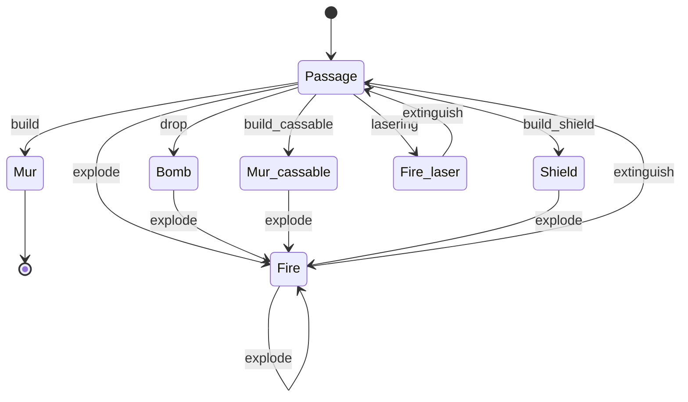

# Structures de données et Algorithmes (`ALGORITHMS.md`)

## 1. Utilisation de graphes
Malgré que notre plateau de jeu soit représenté par une grille (matrice), nous avons quand même créé des graphes de ce plateau (une fois par frame), pour utiliser Dijkstra plus facilement.

## 2. Algorithmes de recherche de chemin (`Recherche.py`)
Utilisation de l'algorithme Dijkstra pour calculer le plus court chemin pour l'IA.
On a également codé un BFS (recherche en largeur), mais nous avons dû le mettre de côté (toujours dans recherche)

## 3. Machine d'état
Les tiles sont gérées par une statemachine (machine d'état). Cela permet une gestion plus fluide de la carte, avec tout de centralisé dans la classe **Tile**. Voici un schéma de la statemachine:
### Machine à états des cases (`Tile`)




## 4. Arbre de décision du Boss (`Ai.py`) **Obsolète**
Le comportement du Boss repose sur un **arbre de décision** hiérarchisant les priorités à chaque image :

```text
               [Le Boss est-il dans une zone de danger ?]
                          /                  \
                        OUI                  NON
                        /                      \
           [Fuir (algo en largeur)]   [Le joueur est-il à portée ?]
                                        /                  \
                                      OUI                  NON
                                      /                      \
                            [Poser une bombe]      [Poursuivre via Dijkstra]
```

* **Pourquoi cette structure ?** : L'arbre de décision garantit que la **survie** (esquiver ses propres bombes ou celles du joueur) reste toujours prioritaire sur l'**attaque** et la **poursuite**, rendant l'IA cohérente et réactive sans comportement suicidaire.
Nous avons changé le level design du boss, pour plus de challenge pour le joueur (l'ancienne version fonctionnelle est dans les commits)